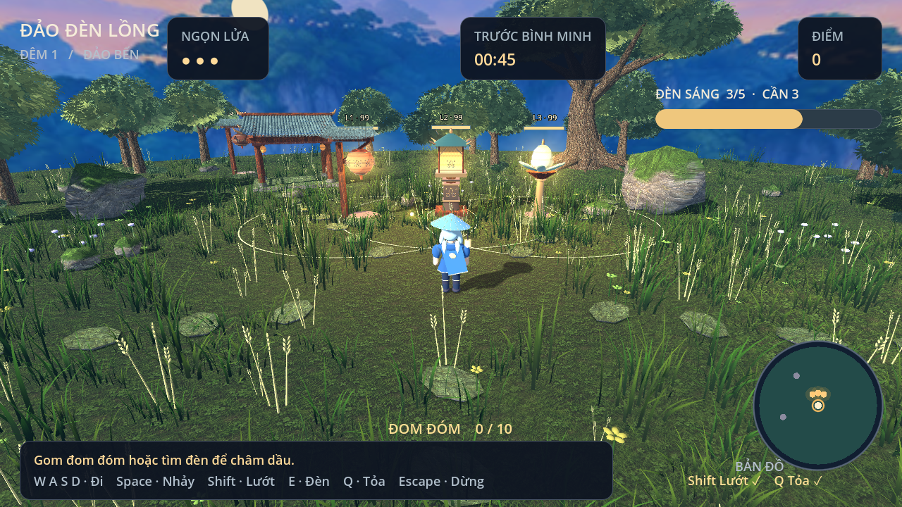

# Đảo Đèn Lồng · v1.0.0

[Chơi thử và kiểm chứng (.mp4)](docs/demo/demo.mp4) · [Ảnh rừng 360°](docs/art/dao-den-long-360.png)



Game 3D Godot 4.5.1 + GDScript. **Bắt đầu hành trình** dẫn Mây qua ba Đêm để giữ đèn sáng tới bình minh. **Khám phá rừng** mở đảo bán kính 60 m với vị trí đèn thay đổi mỗi lần bắt đầu chuyến mới.

## Cài và chạy

Windows x64, macOS hoặc Linux có trình điều khiển OpenGL 3.3. Chạy từ mã nguồn cần Python 3.9 trở lên và Internet ở lần cài Godot đầu tiên. Sau khi clone repo, mở thư mục dự án và chạy hai lệnh trên Windows:

```powershell
python tools/manage.py build
python tools/manage.py play
```

Máy đã có Godot portable có thể mở **Play.cmd**. Trên macOS/Linux dùng `python3` thay cho `python`. Bản ZIP Windows đã đóng gói chỉ cần giải nén rồi mở `DaoDenLong.exe`, không cần Python hoặc Godot Editor. Tự xuất ZIP bằng `python tools/manage.py package` sau khi build.

| Phím | Tác dụng |
|---|---|
| WASD / Chuột | Đi / Xoay camera |
| Space / Shift | Nhảy / Lướt |
| E / Q | Thắp đèn hoặc châm dầu / Tỏa Sáng |
| Esc hoặc P | Tạm dừng, mở cài đặt hoặc chơi lại Đêm |
| R | Chơi lại sau khi thua |

Giữ tối thiểu 3/5, 4/6 hoặc 5/7 đèn tùy Đêm. Thắp lần đầu cần 10 đom đóm, thắp lại cần 5. Đèn dưới 30 dầu mất vùng an toàn. Mỗi lần thắp thành công tăng sức chứa thêm 2, tối đa 20. Trong Cài đặt có đổi phím, bảng màu dễ phân biệt, giảm chuyển động và chữ lớn. Sau khi thua hoặc thắng Đêm 3, nhập tên từ 3–12 ký tự chữ Latin, số hoặc dấu gạch dưới để lưu vào top 10 trên máy.

Mỗi đom đóm nạp cho 5 điểm. Thắp mới cho 100, thắp lại cho 40. Tỏa Sáng trúng Bóng Mực cho 5 điểm nếu không hút dầu, hoặc 15 nếu đang hút. Khi thắng, mỗi đèn sáng cho 50 điểm cộng phần nguyên của lượng dầu, và mỗi Ngọn Lửa còn lại cho 50. Tổng điểm cộng các Đêm đã thắng.

## Kiểm chứng

```sh
python3 tools/verify.py
python3 tools/manage.py gui-test
python3 tools/manage.py headless --seed 2026 --night 3 --ticks 18000 --out result.jsonl
python3 tools/manage.py bench --seed 42 --duration 30 --out bench.json
python3 tools/manage.py soak --seed 7 --nights 10 --out soak.json
python3 tools/manage.py play --export-leaderboard leaderboard.json
```

Benchmark chạy cửa sổ 1280×720 với VSync tắt. Camera quay quanh Đảo Bến với 200 Bóng Mực, 100 đom đóm và ba đèn đầy dầu. Cỏ, nhân vật và hiệu ứng riêng của bản nghệ thuật được giản lược hoặc tắt trong cảnh đo. Cảnh soak chạy headless và đo RSS của tiến trình Godot.

- [Bằng chứng Phase 4](docs/proof/phase-4/README.md), [ticket và cách đo](docs/notes/phase-4.md), [retro bốn phase](docs/notes/retro-final.md)

- [ADR và tiêu chí Phase 3](docs/notes/phase-3.md), [changelog](CHANGELOG.md) và [bằng chứng Phase 3](docs/proof/phase-3/README.md)
- [Bằng chứng Phase 2](docs/proof/phase-2/README.md) và [bằng chứng Phase 1](docs/proof/phase-1/README.md)
- [Test Contract](game.contract.json), [hướng dẫn agent](AGENTS.md), [nhật ký AI](docs/notes/ai-log.md) và [nguồn nội dung](CREDITS.md)

## Sáng tạo của tôi

Rừng có cây cổ thụ, rễ nổi, thảm cỏ nhiều tầng, mái đình và đá phủ rêu. Ba kiểu đèn là đèn giấy treo trên mái, đèn đồng mái cong và đèn sen. Mây mặc áo choàng xanh và đội nón lá. Đom đóm lượn ngang và bay lên trong bản đồ họa. Điểm nhặt trong headless giữ tọa độ chuẩn.

---

# Day 12 — AI SDLC: Đảo Đèn Lồng

> **Cá nhân** (1 người / 1 MSSV) · Áp dụng SDLC cùng AI để xây một **game 3D** qua **4 phase**, từ yêu cầu ban đầu tới bản phát hành.
> **Lab board + trợ giảng:** **[Đảo Đèn Lồng Lab](https://claude.ai/artifact/Q1RYyv1dxjUczzCbd2ZnoW)**

---

## Tài liệu của lab

| File | Nội dung |
|---|---|
| [GUIDE.md](GUIDE.md) | Hướng dẫn làm lab: vòng làm việc mỗi phase, harness, kiểm chứng, token |
| [CHECKPOINTS.md](CHECKPOINTS.md) | Các mốc tự kiểm tra từ chuẩn bị đến nộp bài |
| [SUBMISSION.md](SUBMISSION.md) | Đặt tên repo, hạn nộp, tag, Release, video, checklist |
| [RULES.md](RULES.md) | Quy định: AI, trung thực về bằng chứng, bản quyền, bảo mật |
| [RUBRIC.md](RUBRIC.md) | Thang điểm chi tiết |

## Lab board

Yêu cầu dự án được phát hành tại **[Đảo Đèn Lồng Lab](https://claude.ai/artifact/Q1RYyv1dxjUczzCbd2ZnoW)**. Mỗi phase là một tab (tab chưa phát hành bị khóa), mỗi tab có trợ giảng AI riêng chỉ trả lời trong phạm vi phase đó. Trợ giảng cần đăng nhập claude.ai và dùng lượt Claude của bạn.

## Dự án

**Đảo Đèn Lồng**: game 3D góc nhìn thứ ba. Mây, người giữ đèn nhỏ tuổi, gom đom đóm để thắp lại các Đèn Lồng Lớn và né Bóng Mực trong sương đen.

- Không ràng buộc công nghệ; chạy được trên macOS hoặc Linux.
- Tuân theo **Test Contract** (chế độ headless) để được chấm tự động và so sánh với nhau.

| Phase | Bạn nhận | Nộp |
|---|---|---|
| 1 | **PRD-0** (mô tả tổng quát) + Test Contract | tag `phase-1` |
| 2 | **Ticket-02**, phát hành khi Phase 1 kết thúc | tag `phase-2` |
| 3 | **Ticket-03**, phát hành khi Phase 2 kết thúc | tag `phase-3` |
| 4 | **Ticket-04**, phát hành khi Phase 3 kết thúc | tag `phase-4` + Release `v1.0.0` |

Yêu cầu sẽ được bổ sung và có thể thay đổi giữa các phase, giống dự án thật.

### Lịch 4 giờ

Bài lab kéo dài **4 giờ**. Phase 1 và 2 khoảng **1 giờ**, Phase 3 khoảng **30 phút**, Phase 4 khoảng **1 giờ 30 phút**. Mỗi phase phát hành đúng mốc giờ. Phase mới xuất hiện trên lab board khi tới mốc.

| Mốc | Sự kiện | Hạn tag |
|---|---|---|
| 0h | Phát hành **Phase 1** (PRD-0), gồm cả phần chuẩn bị | `phase-1` trước mốc 1h |
| 1h | Phát hành **Phase 2** | `phase-2` trước mốc 2h |
| 2h | Phát hành **Phase 3** | `phase-3` trước mốc 2h30 |
| 2h30 | Phát hành **Phase 4** | `phase-4`, Release `v1.0.0` và video trước mốc 4h |
| 4h | Hết giờ lab, chốt bài | |

Hết giờ mỗi phase thì tag và chuyển sang phase tiếp theo, dù phase chưa hoàn hảo. Chỗ chưa xong ghi trung thực trong bằng chứng.

---

## Gợi ý SDLC (cách làm là của bạn)

Mỗi phase là một vòng nhỏ. Công cụ, thứ tự, định dạng tài liệu đều tự do; đây chỉ là gợi ý:

1. **Requirements:** biến yêu cầu thành tiêu chí nghiệm thu kiểm chứng được. Chỗ mơ hồ thì tự giả định và ghi lại.
2. **Plan:** nghĩ cách kiểm chứng **trước** khi để agent viết code.
3. **Build:** để agent viết, bạn điều phối và review.
4. **Verify:** chạy thật, kiểm tra hành vi thật. *Không có bằng chứng thì chưa xong*: "agent bảo chạy rồi" không phải bằng chứng.
5. **Evaluate:** cái gì đạt, AI sai ở đâu, harness (AGENTS.md, skill, hook) cần chỉnh gì.
6. **Release:** gắn tag.

## Ba điều cần nhớ

> Bạn được **tự do sáng tạo thêm** quanh phần lõi (nhân vật, cơ chế nhỏ, câu chuyện, hiệu ứng, âm thanh…). Sáng tạo gọn và không phá yêu cầu được tính điểm trong hạng mục F của [RUBRIC](RUBRIC.md); ghi mục "Sáng tạo của tôi" trong README của bạn.

- **Game tốt là game đúng yêu cầu của khách hàng**, không phải game phức tạp hay đẹp nhất. Làm đúng và chứng minh được là đúng trước, trau chuốt sau.
- **Cân nhắc kỹ quota token của bạn.** Đốt nhiều token không làm bài tốt hơn. Ngữ cảnh gọn, kế hoạch rõ, kiểm chứng sớm thường vừa rẻ vừa đúng hơn chạy agent liên tục.
- **Kiểm chứng là phần quan trọng nhất.** Bằng chứng (test, output headless, ảnh, số đo) đáng giá hơn lời mô tả.

---

## Bàn giao cuối cùng

Một **repo GitHub cá nhân, public**, gồm:

1. **Toàn bộ mã nguồn** của game qua 4 phase, tag `phase-1` … `phase-4`, Release `v1.0.0`.
2. **Video demo `.mp4` dưới 5 phút** (đính kèm Release `v1.0.0` hoặc `docs/demo/demo.mp4`, link ở đầu README): chơi thử và cho thấy bằng chứng game chạy đúng.
3. **Bằng chứng kiểm chứng** của từng phase (định dạng tự chọn).
4. **Harness AI đã dùng** (AGENTS.md / CLAUDE.md, skills, hooks, plugins…), giữ nguyên trong repo và lịch sử git.
5. **Ghi chép ngắn:** spec/giả định mỗi phase, nhật ký dùng AI (gồm token/chi phí ước tính), retro.

Không commit API key, token hay `.env`. Gửi link repo theo hướng dẫn của Coach.

## Đánh giá (100 điểm)

| Hạng mục | Điểm |
|---|---|
| Test tự động ẩn (headless, gồm kiểm tra lại phase trước) | 30 |
| Kiểm chứng & bằng chứng của bạn | 20 |
| Quy trình SDLC & harness AI | 15 |
| Evaluation & retro (gồm cách bạn dùng token) | 10 |
| Hiệu năng & ổn định | 10 |
| Chất lượng sản phẩm (đúng yêu cầu, chơi được) | 10 |
| Video demo | 5 |

## Quy định

- Dùng AI thoải mái; không sao chép repo của người khác.
- Bằng chứng phải thật: test luôn đạt hay output sửa tay là vi phạm.
- Nhân vật, bối cảnh là bản gốc của lab; asset bên ngoài chỉ dùng loại CC0/CC-BY/MIT hoặc tự tạo, ghi nguồn trong `CREDITS.md`.
